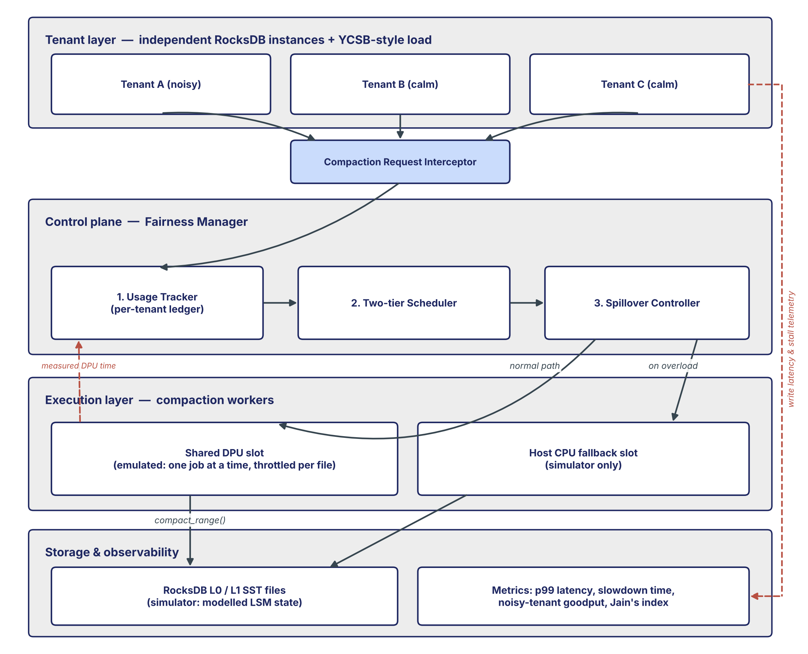
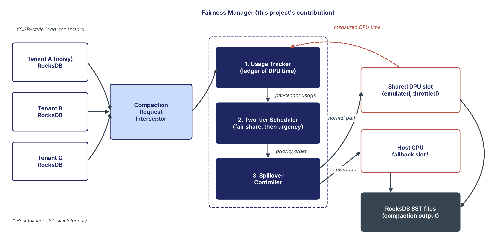
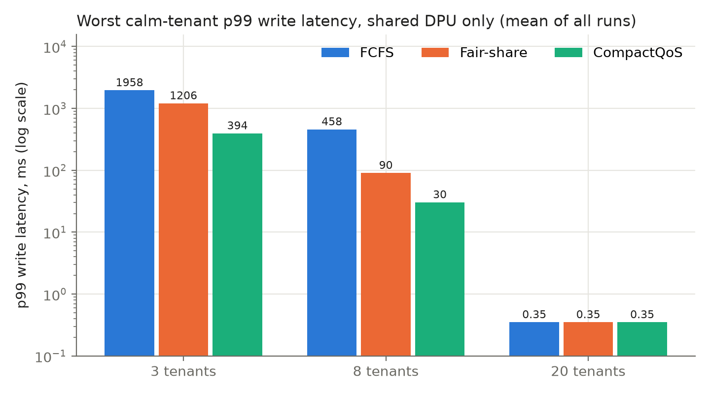
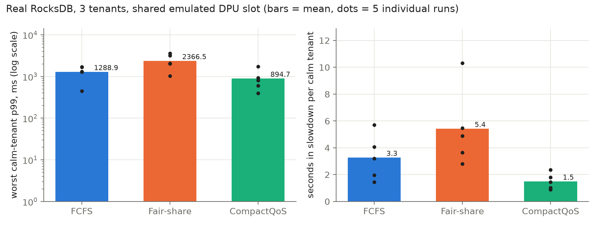
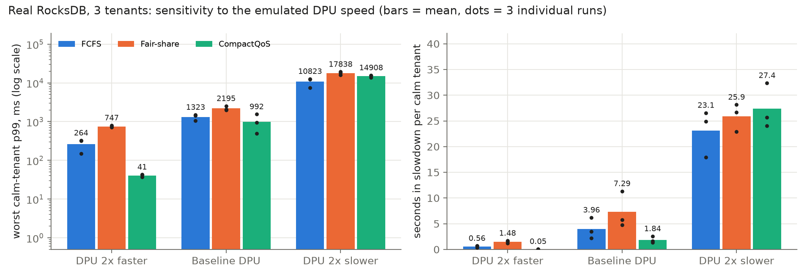
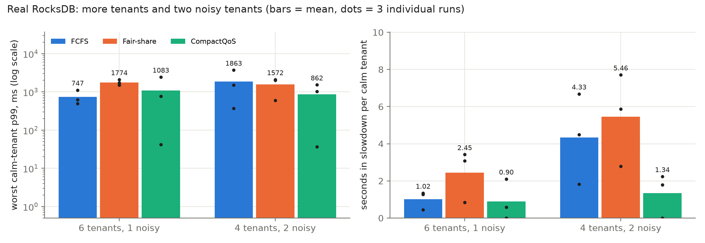

# CompactQoS

**Fair, latency-safe compaction offload for multi-tenant disaggregated cloud storage.**

CompactQoS is a fairness layer for LSM-tree compaction that is offloaded to a shared DPU (data processing unit). It decides whose compaction runs next on the shared device, so one tenant's write burst cannot push its neighbours into write stalls.

Course project for Cloud Infrastructure and Architecture, School of Computer Science and Engineering, VIT Chennai.
Team **WorksOnMyMachine**: Joshwa D Y (25BCE5176), solo project.

## The problem

LSM-tree engines such as RocksDB write data quickly into small sorted files in level 0 (L0) and merge them later in a background job called compaction. If compaction falls behind, L0 files pile up and the engine first slows and then stops incoming writes (a write stall).

Recent systems (D²Comp, CaaS-LSM, O³-LSM) offload compaction to a DPU to save host CPU and network. Their published evaluations have one deployment using the DPU. In a multi-tenant cloud one DPU would be shared by many tenants, and a single tenant's burst can fill the DPU's queue. Calm tenants on the same DPU then drift into write stalls, even though they did nothing wrong.

## Design



| Module | What it does |
|---|---|
| Compaction Request Interceptor | Captures each tenant's compaction requests before they reach the DPU |
| 1. Usage Tracker | Time-decayed ledger of each tenant's recent DPU time (half-life 5 s), updated with the DPU time each job actually used |
| 2. Two-tier Scheduler | Tenants within their fair DPU share go first; within a tier, the tenant closest to a stall (highest L0 count) goes first |
| 3. Spillover Controller | Sends a job to the host-CPU fallback slot: early (L0 ≥ 4) for under-share tenants, only in trouble (L0 ≥ 8) for over-share tenants |



## Repository layout

| File | Purpose |
|---|---|
| `compactqos_sim.py` | Discrete-time simulator: tenants, stall rule, shared DPU slot, host fallback slot, all policies and metrics |
| `rocksdb_harness.py` | The same Fairness Manager running against real RocksDB instances (one per tenant), sharing one emulated DPU slot. Options for tenant count, number of noisy tenants and DPU speed |
| `run_review3_experiments.py` | Runs experiments E1–E3 on real RocksDB and saves results after every run |
| `make_plots.py` | Figures 1–8 and summary tables |
| `plot_review3.py` | Figures 9–10 and `review3_summary.csv` |
| `check_rocksdb.py` | Feasibility test: can Python see and control RocksDB's L0 compaction? |
| `check_stall.py` | Feasibility test: does RocksDB stall writes by itself with auto-compaction off? (It does not; see Limitations) |
| `results_*.csv`, `trace_*.csv` | Simulator results: one row per run (495 runs), summaries, L0 traces |
| `rocksdb_*.csv` | Main RocksDB experiment: one row per run, one row per compaction job, summary |
| `review3_*.csv` | Experiments E1–E3: one row per run, summary |
| `figures/` | Figures 1–10 |
| `docs/` | Architecture and flow diagrams |

## Running it

Tested on a Dell Inspiron 15 3520 (Intel Core i3-1215U, 8 GB RAM), Windows 11 Home, Python 3.14.

```powershell
python -m venv .venv
.venv\Scripts\activate
pip install -r requirements.txt
python compactqos_sim.py --tenants 3 8 20 --seeds 5 --trace   # about 3 minutes
python rocksdb_harness.py --seeds 5                           # about 16 minutes
python make_plots.py                                          # figures 1-8
python run_review3_experiments.py                             # about 47 minutes
python plot_review3.py                                        # figures 9-10
```

On Linux or macOS, activate with `source .venv/bin/activate`.

Quick checks: `python compactqos_sim.py --tenants 3 --seeds 1 --patterns spike`, `python rocksdb_harness.py --duration 20 --seeds 1`, and `python run_review3_experiments.py --quick` (20-second runs, too short for real results).

The simulator uses fixed seeds, so it gives identical results on every run. RocksDB results depend on real timing and vary between runs and machines.

## How it was evaluated

**Simulator.** Each tenant flushes one L0 file every 100 writes. The stall rule mirrors RocksDB (`level0_slowdown_writes_trigger` = 8: writes slow to 80/s; `level0_stop_writes_trigger` = 16: writes block). A compaction job clears 4 L0 files. The shared DPU slot runs one job at a time (0.65 s per job); the host slot is faster (0.30 s) but slows every tenant's writes while busy (×0.6 service rate, +2 ms per write). Tenant A is noisy (100 writes/s, flooding to 3,000 writes/s); calm tenants write 50–150 writes/s with random 3× bursts. The run grid is 3, 8 and 20 tenants × 3 burst patterns × 11 policies × 5 seeds = 495 runs of 120 simulated seconds.

**Real RocksDB.** One RocksDB instance per tenant (via the `rocksdict` binding) with automatic compaction off, so the Fairness Manager owns all compaction. Writer threads issue open-loop writes (Zipf-like keys, 1 KB values); a manager thread polls every tenant's L0 count every 5 ms and dispatches work to one shared emulated DPU slot (a throttle of 0.05 s + 0.15 s per file, then the real `compact_range`). DPU work is done in 4-file chunks so the scheduler can switch tenants between chunks, and every file cleared is charged to the DPU.

**Baselines.** First-come-first-served (FCFS) and round-robin fair-share, on the same hardware as CompactQoS.

**Metrics.** Worst calm-tenant p99 write latency, seconds each calm tenant spent in write slowdown, the noisy tenant's served/offered writes, and Jain's fairness index.

## Results

### Simulator: shared DPU only

Worst calm-tenant p99 write latency, mean of 15 runs:

| Tenants | FCFS | Fair-share | CompactQoS |
|---|---|---|---|
| 3 | 1,958 ms | 1,206 ms | **394 ms** |
| 8 | 458 ms | 90 ms | **30 ms** |
| 20 | 0.35 ms | 0.35 ms | 0.35 ms |



- With 3 tenants CompactQoS cuts the worst calm-tenant p99 about 5× against FCFS and 3× against fair-share; with 8 tenants about 15× and 3×.
- With 20 tenants nobody stalls under any policy: one noisy tenant cannot saturate the larger shared worker.
- The noisy tenant is served the same share under all three policies. CompactQoS changes the order of work, not the capacity.
- **Ablation:** the ledger does nearly all the work. Without it, urgency alone serves the noisy tenant first (it is always the closest to a stall) and calm tenants do worse than plain fair-share (1,386 ms at 3 tenants). Removing urgency barely changes results (413 against 394 ms).
- **With a host fallback slot** for every policy, all three tie on calm-tenant latency (2.35 ms) and CompactQoS keeps the host CPU busy slightly less (0.65 against 0.67 at 3 tenants).

### Real RocksDB: 3 tenants, 5 runs of 60 s

| | FCFS | Fair-share | CompactQoS |
|---|---|---|---|
| Worst calm-tenant p99, mean (range) | 1,289 ms (451–1,707) | 2,367 ms (1,020–3,553) | **895 ms (395–1,734)** |
| Seconds each calm tenant spent in slowdown, mean | 3.27 | 5.43 | **1.50** |
| Noisy tenant: served / offered | 0.26 | 0.24 | 0.24 |
| Median calm-tenant write latency | 0.71 ms | 0.76 ms | 0.68 ms |



- CompactQoS had the least slowdown time in all 5 runs (narrowly in run 1: 1.44 against 1.45 s), about 2.2× less than FCFS on average.
- Its mean worst-case p99 was about 1.4× lower than FCFS. It had the lowest p99 in 3 of 5 runs; FCFS was lower in run 1 (451 against 934 ms) and, narrowly, in run 5 (1,707 against 1,734 ms).
- Unlike in the simulator, round-robin fair-share did worse than FCFS: interleaving chunks stretches calm tenants' own jobs.
- Real compaction took 81 ms on average over 565 jobs (max 257 ms). Most of each job's time (0.7–6.3 s) is the emulated DPU throttle, which is why E1 varies it.

### Where it holds: experiments E1–E3 on real RocksDB, 3 runs of 60 s each

| Scenario | FCFS | Fair-share | CompactQoS | CompactQoS lowest p99 | CompactQoS least slowdown |
|---|---|---|---|---|---|
| E1: DPU 2× faster | 264 ms | 747 ms | **41 ms** | 3 of 3 | 3 of 3 |
| E1: baseline DPU | 1,323 ms | 2,195 ms | **992 ms** | 2 of 3 | 3 of 3 |
| E1: DPU 2× slower | **10,823 ms** | 17,838 ms | 14,908 ms | 0 of 3 | 1 of 3 |
| E2: 6 tenants, 1 noisy | **747 ms** | 1,774 ms | 1,083 ms | 2 of 3 | 2 of 3 |
| E3: 4 tenants, 2 noisy | 1,863 ms | 1,572 ms | **862 ms** | 2 of 3 | 3 of 3 |

Worst calm-tenant p99, mean of 3 runs (lowest in bold).




- **Faster DPU, baseline DPU, two noisy tenants:** CompactQoS had the least slowdown in every run (0.05 against 0.56 s, 1.84 against 3.96 s and 1.34 against 4.33 s for FCFS) and the lowest mean p99.
- **6 tenants:** mixed. CompactQoS had the lowest p99 in 2 of 3 runs, but one run reached 2,441 ms, so FCFS had the lower mean (747 against 1,083 ms). Three runs are too few to tell whether that run is an outlier.
- **DPU 2× slower:** every policy fails (worst p99 11–18 s, over 20 of 60 s in slowdown) and FCFS does best. The DPU cannot keep up even with the calm tenants, so this is under-provisioning that no scheduling order fixes.

**Overhead:** a scheduling decision takes about 7–15 µs in the simulator and about 36 µs in the RocksDB harness (Python), negligible next to a compaction job.

## Limitations

- **Emulated DPU.** There is no real DPU and no cgroups. The shared DPU is a single job slot with a throttle delay per file. Absolute numbers depend on those parameters; the comparison between policies is the result.
- **Emulated write stall.** `check_stall.py` showed RocksDB does not apply its L0 write stall when automatic compaction is off (median write latency 0.350 ms against 0.358 ms with 57 L0 files), so the simulator and the harness apply RocksDB's L0 rule themselves.
- **Scope of the RocksDB runs.** Up to 6 tenants, one burst pattern (spike), one machine, DPU slot only (no host fallback), and 3–5 runs per scenario, which is too few for confidence intervals.
- **Load generator.** YCSB-style (Poisson arrivals, bursts, Zipf-like keys), not the YCSB benchmark itself.
- **Simulator simplifications.** Every simulated job clears 4 files, and the host slot's penalty to foreground writes (×0.6, +2 ms) is an assumption, not a measurement.

## Future work

- Real DPU hardware (for example NVIDIA BlueField) and cgroup-capped workers on Linux.
- The host fallback slot in the RocksDB harness, and larger tenant counts.
- Variable compaction job sizes, real workload traces and the real YCSB benchmark.
- Detecting and reporting an under-provisioned DPU, since scheduling cannot fix it.
- Hardening against tenants who game the urgency signal.

## References

1. C. Ding et al. "D²Comp: Efficient Offload of LSM-tree Compaction with Data Processing Units on Disaggregated Storage." ACM TACO, 2024 (extends DComp, ICPP 2023).
2. Q. Yu et al. "CaaS-LSM: Compaction-as-a-Service for LSM-based Key-Value Stores in Storage Disaggregated Infrastructure." SIGMOD 2024.
3. Q. Lin et al. "O³-LSM: Maximizing Disaggregated LSM Write Performance via Three-Layer Offloading." SIGMOD 2026 (arXiv:2603.05439).
4. RocksDB documentation: Write Stalls; Compaction. https://github.com/facebook/rocksdb/wiki
5. R. Jain, D. Chiu, W. Hawe. "A Quantitative Measure of Fairness and Discrimination for Resource Allocation in Shared Computer Systems." DEC Technical Report, 1984.
